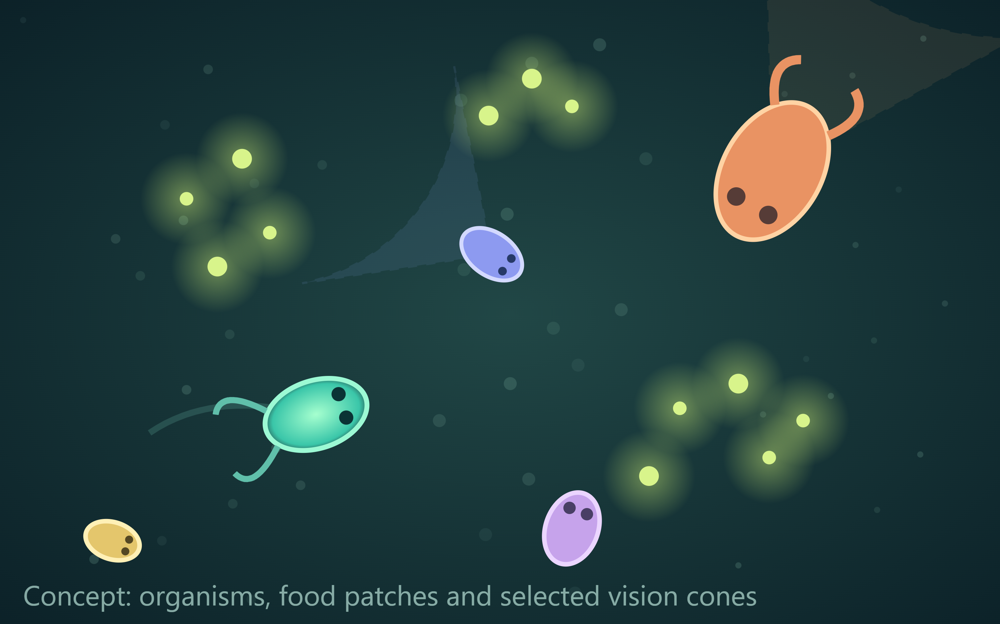
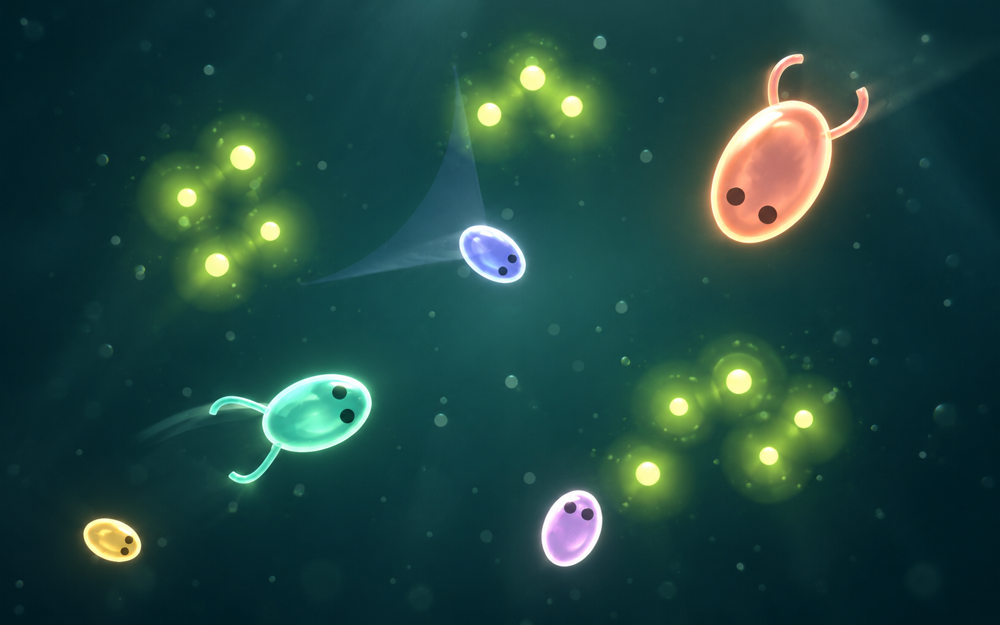
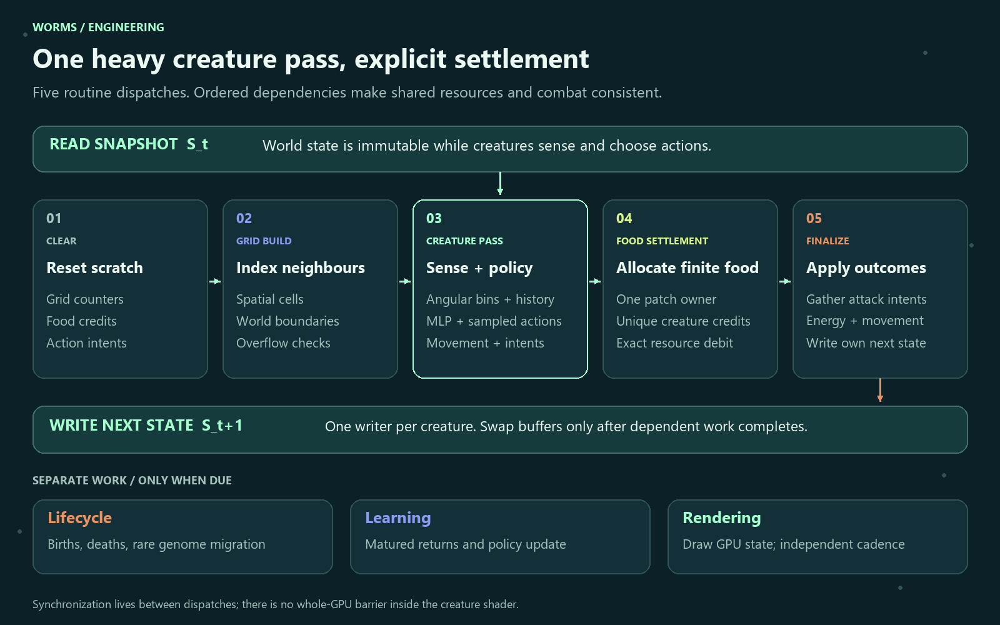
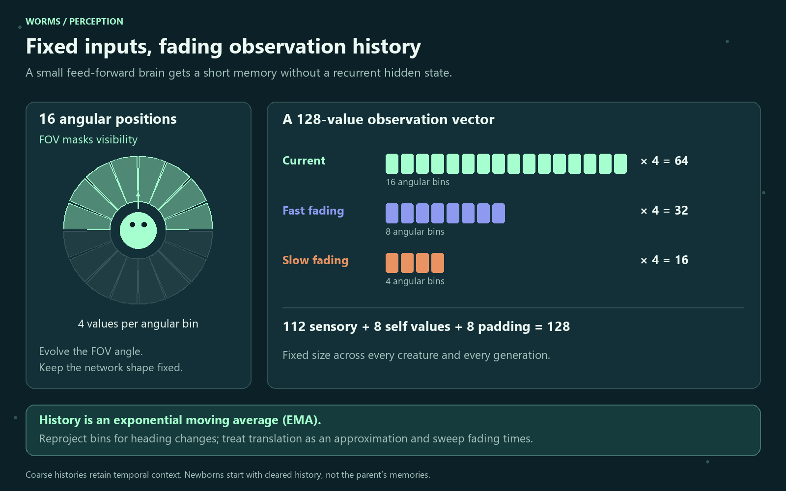
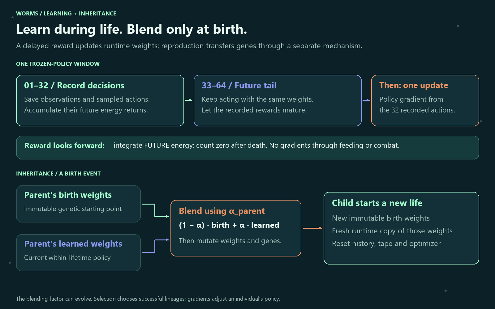
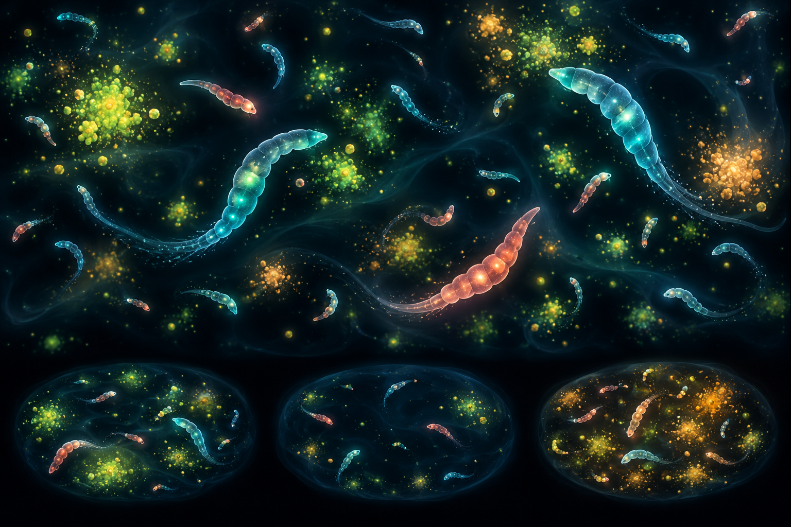

# Visual direction and provenance

The supplied illustration establishes the intended complexity: **simple ellipsoids with little limbs and eyes**. The desired finish adds translucency, soft internal shading, gentle highlights, controlled bloom and atmosphere while keeping that anatomy and clear composition.

## Shape and composition reference

- **assets/user-reference-original.png** is a byte-for-byte copy of the user's supplied 3025 × 1889 pixel image.
- **download.svg** is the original file supplied in C:/dev/worms, preserved unchanged.
- **assets/user-reference.svg** is a byte-for-byte project asset copy of that SVG.
- **assets/user-reference.png** is a 1360 × 860 rendering of the SVG for viewers that cannot display SVG. It is not a reconstruction of the pixel attachment.

The accessible earlier conversation returned no recoverable image attachments. The user subsequently supplied both the SVG and pixel image during this continuation; those are the authoritative references. The original conversation's factual design ideas are incorporated into the plan.

## Material and lighting target

**assets/ellipsoid-glow-concept.png** is a new AI-generated edit of the supplied pixel image, made with the built-in image-generation tool on 24 October 2026. It preserves the basic five-creature composition and simple anatomy while exploring translucent gel shading, luminous rims and glowing food. It is concept art, not a screenshot of working simulation code.

The production renderer should offer a glow control and keep crowded scenes clearer than a still illustration. Eyes and silhouettes must remain readable. Vision cones are inspection overlays; their orientation must follow simulation heading, not merely the direction drawn in a reference. Actual translucency, bloom and particles have separate GPU costs and are staged in the project plan.

### Final prompt used

Use case: style-transfer
Asset type: polished visual direction concept for a small artificial-life simulation.
Edit target: attached user-reference-original.png. Preserve the basic scene, organism count and composition, silhouettes, their colors, visible eyes, simple ellipsoidal bodies, short curved limbs, clusters of food, dark teal pond and generous empty space. These simple shapes are the intended maximum anatomical complexity. Make the rendering more luminous, realistic in its materials, translucent and beautiful, without adding anatomical complexity.
Give the ellipsoids softly translucent gel bodies with subtly visible depth, gentle internal shading, soft mint/coral/lavender/yellow colored transmission, a delicate luminous rim, understated specular highlights. Retain the small simple dark eyes, clearly visible and expressive. Small curved limbs stay simple. Food particles glow softly in lime; restrained localized bloom and faint particulate depth. The pond has a subtle dark teal gradient, a very quiet watery atmosphere, no elaborate terrain. Preserve readable silhouettes and dark negative space; beautiful high-end real-time 2.5D game art, not horror microscopy. Vision cones optional extremely faint, visually subordinate. Remove the bottom caption and all text. No segmented worms, no long tentacles, no jellyfish, no detailed organs, no extra creatures, no UI chrome. Preserve full landscape composition and fit all creatures in view. This is concept art, not a simulation screenshot.

## Engineering diagrams

These are deterministic diagrams created for this plan, not recovered conversation images. Each has a PNG for Markdown and an editable SVG with the same stem:

| File stem | Purpose |
|---|---|
| assets/tick-pipeline | Immutable state, five routine baseline passes, and separate lifecycle/learning/render work |
| assets/sensory-history | Fixed angular bins, FOV masking, fading history and 128-input layout |
| assets/learning-inheritance | Frozen recorded/tail windows, future reward and inherited weight blend |

The tick diagram simplifies optional work: when learning is enabled, an additional small energy-prefix bookkeeping pass follows lifecycle each tick; neural weight updates happen only at block boundaries.

## Earlier mood exploration

**assets/ecosystem-exploration.png** was generated with the built-in tool before the original reference arrived. Retain it as an optional mood reference for atmospheric color and isolated worlds. Segmented bodies are not the chosen anatomical direction and are not an implementation requirement.

### Final prompt used

Use case: stylized-concept
Asset type: landscape visual direction image for a small artificial-life simulation project named Worms; not a screenshot or evidence of an implemented simulation.
Primary request: A visually beautiful top-down microscopic ecosystem of many tiny soft, short worm-like artificial organisms moving through scattered food patches in a dark luminous fluid-like plane. A few large curved worms and dozens of small distant ones, each made of 5–9 smooth tapered segments, restrained translucent bodies, subtle internal light. Cyan and teal creatures, a few warm coral lineages, soft lime and amber food patches. Short fading trails suggest recent motion, with generous dark negative space so behavior remains readable. A quiet organic laboratory aesthetic, sophisticated scientific visualization, beautifully restrained bloom and depth, rich charcoal/navy background. Show an intimate readable ecosystem rather than dense visual noise. At the lower edge, three small clearly separated inset habitat worlds echo the main one with subtly different food densities, suggesting separate worlds; no connecting physical tunnels. Rectangular landscape framing, crisp organism silhouettes at 1536x1024-class resolution. No text, no labels, no UI chrome, no grids, no photoreal insects, no jellyfish, no tentacle forest. This is new concept art inspired by a description; do not imply it reproduces a missing original image.

## Asset handling

Original supplied assets have not been edited. Both generated concepts are saved in this project, not referenced from a temporary or tool-managed path. The original generated tool outputs are also left in place. PNG diagrams and SVG geometry were visually checked; all relative image references are verified before delivery.
