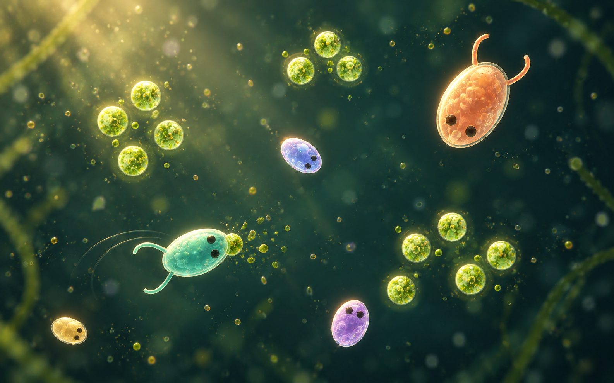
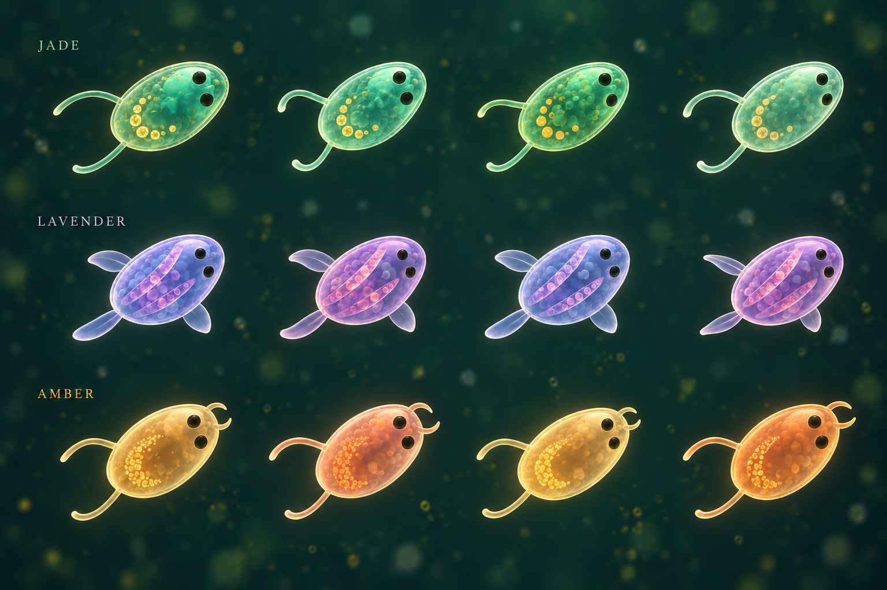
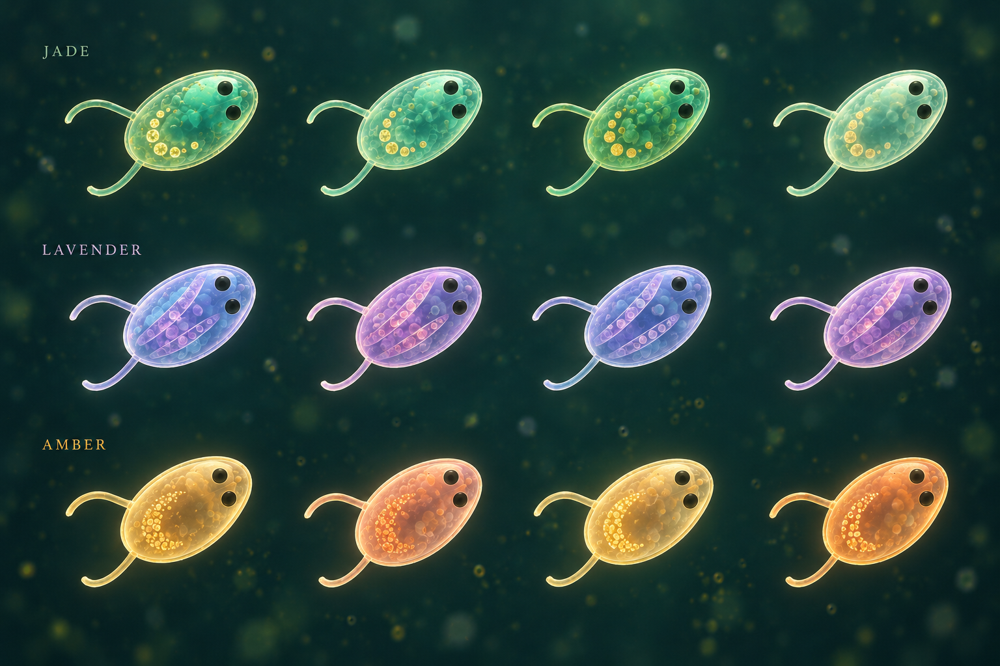
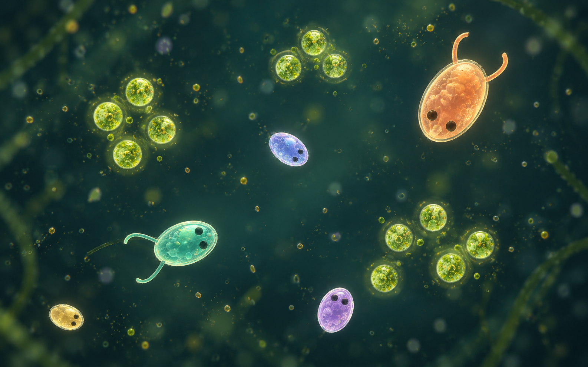
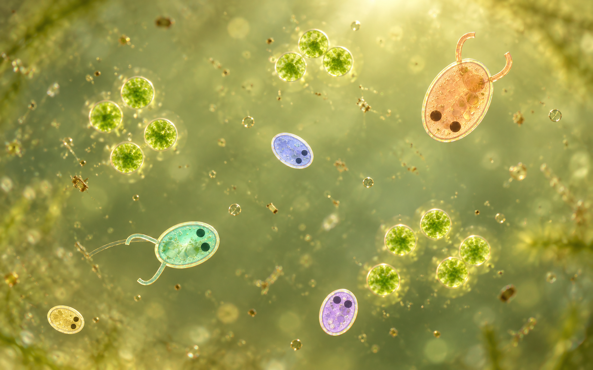

# Visual direction and provenance

The supplied illustration establishes the starting complexity: **simple ellipsoids with little limbs and eyes**. The chosen direction adds translucent microscopic materials, directional light and soft bokeh, plus gradual inherited variation in markings, eyes, limbs, fins and mandibles. Keep the oval bodies and clear composition.

## Chosen direction: dark pond, light, effects and family resemblance

The user selected the dark pond and soft bokeh, and requested directional lighting,
ripples, food-disintegration particles, eventual combat effects, and inherited
visual variation. Eye size and position, limbs, fins and mandibles are explicitly
in scope. These extend the original shape vocabulary while retaining simple oval
bodies. This is agreed visual direction; the effects and appearance genes below
are proposed implementation, not existing features.

### Light and motion study



Keep the deep teal water and sharp gameplay plane. A broad soft light gives
membranes a consistent warm edge and cool shaded side. The light should stay fixed
relative to the pond as organisms turn. The study makes the light and wake easy to
see; use lower intensity and fewer ambient specks in a busy live scene.

| Event | Visual treatment |
|---|---|
| Swimming / disturbance | A few thin incomplete refractive arcs and faint displaced motes, fading locally |
| Food consumed or destroyed | The piece breaks into a small green-gold cloud of fragments that rapidly disperse and fade |
| Confirmed combat contact, later | A brief membrane pulse, small ripple and a few tinted flecks at the contact point |

Background bokeh, actual food and event fragments need different focus, scale and
motion so decoration cannot be mistaken for an edible target. Effects remain
subordinate to eyes, silhouettes and inspection overlays. Cosmetic ripples do not
require a fluid simulation.

### Inherited anatomy and markings

The [concrete visual-trait catalogue and comparison grids](VISUAL_TRAITS.md)
define twelve inheritable trait groups, their controls, a common baseline and
the distinction between inherited traits and temporary visual state.



Each row illustrates relatives with a common visual identity and small individual
differences. Jade, lavender and amber are example families, not fixed species or
gameplay classes. Markings and anatomical traits can combine independently.

| Inherited feature | Gradual variation |
|---|---|
| Pigment and membrane | Hue, saturation, secondary tint, transmission and rim strength |
| Internal markings | Freckles, soft bands, vesicle distribution, spacing and contrast |
| Eyes | Diameter, separation and position along the body, with readable paired eyes |
| Limbs | Length, curvature, taper and attachment position |
| Fins | Prominence, width, taper and attachment position |
| Mandibles | Length, curvature, separation and resting opening angle |

The design goal is recognizable cousins, not a new random appearance at every
birth. Copy a parent's appearance traits into both offspring, then apply small
independent bounded mutations. A stable inherited pattern seed plus gently
changing continuous parameters preserves a family motif; hashing each whole brain
or new creature ID into a fresh appearance would destroy that continuity.
Appearance can drift over generations without implying that visually similar
creatures have identical behavior. These are cosmetic inherited traits initially,
not a claim of adaptive evolution or a measure of neural-network similarity.

Keep simple procedural geometry and modest appendage sizes. Fin prominence and
jaw dimensions can start near zero and grow gradually rather than abruptly
switching species. Preserve symmetry sufficiently for readable faces; no need
for biological realism. Cosmetic eye size does not change sensing, mandibles do
not imply a new attack rule, and decorative fins or limbs do not change contact
radii. Functional trait effects would be a separate mechanics decision.

The earlier study isolates pigment and pattern inheritance:



### Procedural interiors with inherited noise parameters

Use a small layered procedural material for the interior art. The user's proposed
direction is to inherit and slowly mutate the noise parameters themselves, so
relatives share recognizable internal structure without requiring unique painted
textures. This remains a rendering proposal.

Start with three restrained layers: broad soft noise for cloudy cytoplasm,
cellular noise for rounded vesicle-like shapes, and fine sparse noise for pigment
speckles. A smoothly warped band field can mix with the speckles to produce the
soft stripes in the concept sheet. These suggest microscopic structures rather
than modeling organs.

Inherit the founder's pattern seed and continuous material traits: spatial scale,
stretch and orientation, coordinate offset, warp strength, layer weights,
speckle density, threshold softness, contrast and pigment tint. Both children
copy the parent, then receive small independent bounded changes. Do not mutate
the integer seed as an ordinary numeric trait: even a one-bit change can replace
the whole pattern. Slow drift in coarse layers preserves the family motif while
fine layers can vary a little more. Smooth thresholds and continuous layer blends
avoid abrupt pattern switches; mutation magnitudes still need visual calibration.

Evaluate the fields in normalized body-local coordinates so markings turn and
travel with the creature. Inherited offsets alter the pattern gradually at birth;
they are not frame-by-frame random offsets. Any optional internal motion should
be subtle and bounded around the inherited pattern, driven by simulation time so
pause freezes it. Keep appearance independent of energy and temporary lighting.

Use the fields to modulate absorption/tint, apparent transmission and soft
internal shading, masked inside the membrane and subordinate to the eyes. Fade
fine layers as the creature becomes small on screen and soften thresholds to
avoid glittering or moire. Keep the initial layer count low and measure shader
cost before adding more detail; procedural generation is not a performance claim.

### Candidate render structure and animated appendages

Keep procedural creature rendering as the starting point. The current renderer
already uses separate background, vision, food and creature draws; each creature
is an instanced quad whose fragment shader combines an ellipse, eyes and mirrored
two-segment limbs. Procedural interiors, simple fins, mandibles and directional
material lighting fit that approach without a mesh for the body.

For flexible limbs, define a tapered centerline in body-local coordinates. Keep
its root attached and increase wave amplitude toward the tip, for example with
an amplitude envelope proportional to squared distance along the limb. A smooth
traveling wave changes the centerline over simulation time. Start by approximating
it with a few short distance-tested segments; use a smooth taper and antialiasing
to hide joins. Inherit length, rest curvature, taper, wave amplitude and frequency,
with an individual phase offset. Fin edges can use a similar anchored deformation;
mandibles can open around an attachment point.

Evaluate the moving centerline once per instance where practical if repeated
fragment work becomes costly. A small vertex-deformed ribbon is another option
for longer or more numerous limbs: geometry follows the same procedural curve,
while its fragment shader supplies the material. This can keep rasterization
close to the visible appendage instead of enlarging every body quad. Choose after
measuring; keeping every feature inside one fragment entry point is not a goal.

The current fixed quad extent of 1.38 must cover any new appendage and its full
animation range, or be replaced with suitable per-instance bounds. Preserve
wrapped copies at world edges. Keep material coordinates attached to the body or
limb, and use simulation time for motion. Rotate a pond-fixed light into local
coordinates so the light direction does not rotate with the creature.

Background bokeh and event particles belong in their own batched draws. Actual
scene refraction and bloom, if later wanted, would require scene textures and/or
additional passes. None of these choices requires CPU readback of creature state.

### Implementation notes for the later rendering pass

- Keep appearance data on the GPU alongside creature slots. Existing body color
  already copies at a split; extend this with explicit inheritable appearance
  values. The current `Creature.lineage` field means benchmark cohort, so it must
  not be repurposed as a family identifier.
- Use separate deterministic cosmetic random streams for founder appearance,
  offspring changes and event fragments. Rendering settings, dropped particles
  and frame rate must never alter brain mutations, energy or contact decisions.
- Emit food-removal events only after the authoritative contact winner is
  validated, before clearing that piece. Store its position, simulation tick and
  stable event identity. A particle burst depicts removal, not a claim about the
  exact age-adjusted energy credited to the eater.
- A bounded GPU event history can expand into a few analytic particle sprites
  and ripple arcs at render time. One latest removal event per food slot is a
  possible simple first design; rapid slot reuse may replace an older visual.
  Overflow or replacement may discard effects only.
- Retain events across simulation chunks, not just one rendered frame. Age them
  using the displayed world's simulation tick: pause freezes them, single-step
  advances them, and accelerated runs naturally expire old effects without
  accumulating a presentation backlog. Wrap positions and visual footprints.
- Save inherited appearance with live worlds, reference cohorts and trials. Plan
  explicit snapshot-version handling; old checkpoints cannot recover complete
  ancestry from an immediate parent ID alone. Define whether transient effects
  are saved or cleared on restore before promising capture continuity.
- Begin with materials and lighting, then inherited appearance and food/wake
  effects. Add combat effects when authoritative combat events exist. Measure
  crowded scenes before enabling dense particles, true refraction or full-scene
  depth of field.

No application or shader code was changed for these studies.

### Refinement provenance and final prompts

All three images were generated with the built-in image-generation tool on
25 October 2026, with opaque output. The lighting and pigment studies edit
[the first dark concept](../assets/concepts/pond-darkfield.png). The anatomy study
edits the pigment study. They are concept art, not captures of the application.

**Light and motion**

```text
Use case: style-transfer
Asset type: refined visual concept for Worms, a top-down microscopic pond-life game. Concept art, not an actual screenshot.
Edit target: supplied pond-darkfield.png. Preserve the dark teal/olive water, gentle bokeh, five original simple ellipsoid organisms with clear tiny dark eyes and short curved limbs, their approximate composition, colors and scale, translucent living membranes and faint cellular interiors. This is a refinement of the approved dark direction.
Primary request: add a clear but subtle sense of lighting and restrained event effects while making the scene calmer and more beautiful.
Lighting: introduce one broad soft warm transmitted light entering diagonally from upper left, gently revealing particles in a patch of water. This is a diffuse pool of light with a very faint broad shaft, not a spotlight or strong sunbeam. On every creature, a warm pearly highlight on the upper-left membrane and cool soft shaded edge opposite establish consistent volume. Keep most of the pond dark with clean negative space. Soft background bokeh remains visible and dim.
Particles and water motion: behind the swimming mint creature show only two thin curved incomplete refractive ripple arcs and a few tiny drifting motes, fading quickly. Very subtle local wakes, not ocean ripples or full concentric circles everywhere. Place one small green food granule at contact with the mint creature's front end; show that single granule just disintegrating into a small localized cloud of 10–20 green-gold soft organic fragments, wisps and dim points. Other food remains intact in the pond. The fragments read as food being consumed, not a firework, explosion or sparks.
Inherited appearance hint: the two lavender organisms are visually related, sharing a faint curved arrangement of little pearly internal flecks and the same violet membrane tint, with a modest difference in fleck spacing and tint. The other organisms retain their separate appearances. All markings stay inside membranes and stay subtle enough to discover up close; do not add elaborate anatomy.
Readability: reduce the reference's tiny decorative dust density by about half; use sharp focus for active creatures and food, bokeh only for sparse cosmetic foreground/background dust. All eyes clear. Crisp ellipsoid silhouettes, quiet interiors, controlled highlights. No global blur. Broad dark open water around subjects.
Style: exquisite naturalistic microscopy-inspired real-time game concept, translucent living cells, restrained optical depth, inviting simple character design. Wide landscape frame.
Avoid: text, UI, labels, logos, anatomy complexity, segmented worms, long tentacles, extra creatures, neon auras, many ripples, thick rings, explosions, fight effects, clutter, terrain, ocean surface, realistic insects, bright background.
```

**Pigment and pattern inheritance**

```text
Use case: stylized-concept
Asset type: organism family-resemblance art direction sheet for the game Worms; a conceptual display of inherited appearance, not a game screenshot or scientific phylogeny.
Edit target: supplied pond-darkfield.png. Recompose it into a beautiful deliberate specimen design sheet while preserving its simple ellipsoid anatomy with exactly two small dark eyes per organism, occasional two short curved limbs, translucent living membranes, faint internal cellular detail, deep teal microscopic water and restrained pearly warm directional highlights.
Primary request: show three visual families of related organisms. Inheritance is expressed by small tasteful changes in pigmentation and pattern, so cousins look related without appearing identical. The variations are discovered on close inspection.
Composition: landscape 3:2-ish art board, twelve clearly separated organisms in three horizontal rows of four. All creatures at comparable display scale and roughly the same diagonal heading so small differences are comparable. Three clean horizontal rows, four organisms in each, generous margins and dark space. No connecting arrows, UI frames or family tree diagram. The water behind the specimens is dark and quiet with extremely sparse soft bokeh.
Row 1: four members of a jade family. Sea-glass green pigment, a distinctive faint curved band of six small pale gold freckles inside the body, same paired short gently curved limbs. Across the four cousins vary the hue very slightly from jade to mint, vary the spacing and diameter of the same freckles and the fine membrane highlight thickness, but preserve a recognizable shared motif.
Row 2: four members of a lavender family. Muted violet pigment, two soft near-transparent oblique internal bands with small rounded vesicles, two short curved limbs. Gently change band spacing, violet warmth and optical translucency between cousins while keeping family resemblance obvious.
Row 3: four members of an amber family. Pale honey/peach pigment, a small crescent grouping of fine internal speckles on one side and a warm membrane. Gently vary speckle distribution and warm tint between cousins, retaining the crescent motif and simple oval anatomy.
All organisms stay simple oval living cells, exactly two dark eyes, no extra body parts, no categorical random redesigns within a row, no ornament stuck outside the body. Cosmetic microtexture has a stable family pattern, not random noise. Do not show increasing physical size as evolution; each row is four related individuals rather than an age progression. Clear dark eyes and consistent crisp silhouettes on a sharp focal plane.
Lighting: soft broad warm transmitted light from upper left, subtle cool shadows, no hot neon rims. Beautiful translucent interiors, quiet restrained biological materials.
Text: exactly three small elegant unobtrusive labels at the left above their corresponding row: "JADE", "LAVENDER", "AMBER". No other text.
Avoid: numbers, genealogy lines, charts, grids, cards, extra organisms, segmented worms, tentacles, photoreal organs, crowded background, food clusters, glowing explosions, excessive bokeh, cartoon toy plastic. This sheet explores subtle inheritable visual identity, not new species or gameplay mechanics.
```

**Inherited anatomy**

```text
Use case: style-transfer
Asset type: refined family-resemblance and inherited morphology concept sheet for Worms, a microscopic artificial-life game.
Edit target: supplied pond-family-resemblance sheet. Preserve its dark teal water, quiet bokeh, three rows of four comparable-scale organisms, row colors, restrained translucent cellular materials, readable oval bodies, and labels JADE, LAVENDER, AMBER. Keep all twelve organisms fully inside frame. This is concept art, not implemented gameplay.
Primary request: extend the family resemblance from just markings into simple inherited anatomical variation. Eye size and placement, limb length and curvature, small fins, and paired mandibles can drift gradually. Related individuals should share a recognizable family silhouette while each differs subtly. This is whimsical biology, not realistic insect anatomy.
Shared design: each organism has exactly two simple dark eye dots facing toward the upper right, a translucent ellipsoid body with subtle family markings, and very few tiny delicate appendages. Each row contains four relatives at roughly the same display scale and diagonal heading. Variation within each row is modest and continuous, not four different species or an age/size progression.
JADE row: retain sea-glass green pigment and the soft crescent of gold freckles. Four relatives each have two simple slender gently curved limbs. Vary those limbs visibly but slightly in length, curve, tip taper and attachment angle across cousins. Vary the two eyes in diameter, spacing and distance from the front edge. Keep the same familial face and two-limb plan.
LAVENDER row: retain violet pigment and faint oblique internal bands. Give each of the four relatives TWO small translucent lateral fins, one on either side of the oval body, attached visibly to the membrane near the middle. Thin clear petal-like paddle fins with a faint rim, no complex veins, each fin no more than one fifth of body length. Vary fin width, taper and attachment position slightly across cousins. Their eyes are modestly wider-set and smaller than the jade family; subtle individual differences in eye size and spacing. These are clearly FIN structures rather than long curled limbs or giant wings. Preserve the same basic oval body.
AMBER row: retain honey/peach pigment and fine internal crescent speckles. Give each of the four relatives two tiny smooth curved mandibles at the FRONT end, directly ahead of the two eyes at the upper-right tip. Paired little translucent amber crescent hooks or nippers, no teeth, no tusks, no facial horror. Each jaw no longer than one eighth of body length. Small paired side limbs remain at the rear. Across cousins, gently vary mandible opening angle, length, curve and eye spacing. The shared front-end jaw silhouette makes their kinship recognizable.
Render morphology clearly enough that each family is distinguishable even with colors muted; preserve the friendly calm microscopic character and anatomy simplicity. All changes must look like a few inexpensive procedural shapes added to an ellipsoid, not elaborate animals. Existing markings still contribute but should not overpower the body and appendages.
Lighting: consistent soft warm transmitted light from upper left, delicate pearly membrane edges, cool quiet shadows, sharp eyes, bokeh only in the background.
Text: exactly the existing three row labels "JADE", "LAVENDER", "AMBER"; no other text.
Avoid: extra specimens, extra eyes, diagrams, arrows, grids, UI, realism claims, insects, segmented bodies, many legs, spikes, long tentacles, feathers, giant fins, fish tails, sharp teeth, dramatic weapons, aggressive expressions, creature size progression, bright busy backgrounds.
```

## Microscopic pond-life exploration — 25 October 2026

Two new concepts explore the user's request for a more beautiful microscopic pond,
with a slight bokeh feel while retaining the existing structure. Both were generated
with the built-in image-generation tool, using the original supplied pixel image as
the edit target. These are proposed art directions, not application captures or
evidence of implemented rendering. The previous references remain below.

### Dark-field pond



The chosen starting direction: translucent living membranes, small internal
vesicles, fine cellular grain, subdued teal water and warm transmitted highlights.
The five simple bodies, eyes, short limbs and food clusters remain recognizable.
This is a material and illumination reference; reduce the decorative particulate
density when translating it to a crowded live scene.

### Sunlit sample



A brighter alternative with sage and olive water, honey light and delicate
membranes. It feels closer to a sunlit pond sample. Preserve stronger silhouettes
and lower background contrast when adapting it for many small organisms.

### Translation to the game

- Keep all active organisms and edible food in one sharp gameplay plane. Create
  slight bokeh with sparse cosmetic foreground/background motes; do not blur
  targets, eyes, selection or inspection overlays.
- Replace uniform bright outlines with thinner, uneven membrane highlights and
  softly shaded interiors. Limit cellular detail at small screen sizes.
- Make food resemble small chlorophyll-rich granules, distinguishable from
  noninteractive dust by shape, focus and contrast.
- Use quiet layered water color and restrained bloom. Keep enough open space for
  motion and overlaps to remain legible.
- Retain simple ellipsoids, eyes and short limbs. The optical depth is cosmetic:
  it does not imply physical depth, new obstacles, species or fluid mechanics.

The current renderer uses analytic instanced shapes and draws directly to an sRGB
target. Richer body shading, a procedural background and defocused particle sprites
are plausible first steps within that design. True refraction, full-scene depth of
field and HDR bloom would need additional rendering work and measurement. This
exploration makes no performance claims and changes no simulation or render code.

### Final prompts

**Dark-field pond — built-in tool, opaque output, original pixel reference as edit target**

```text
Use case: style-transfer
Asset type: landscape concept art for the game Worms, a small top-down artificial-life simulation. This is a visual exploration, not an actual game screenshot.
Edit target: the supplied local image user-reference-original.png, the authoritative shape and composition reference. Retain its five organisms, approximate arrangement, relative scale, simple ellipsoid bodies, two small dark eyes, occasional two short curved limbs, and three small clusters of food. Keep the simple anatomy and easy-to-read open composition. Remove all captions and vision cones.
Primary request: make the scene exceptionally beautiful, with a convincing intimate feeling of microscopic pond life and a slight optical bokeh feel. Evolve the flat illustration into sophisticated naturalistic microscopy-inspired game concept art.
Scene: a tiny living water sample, top-down orthographic composition, deep translucent petrol teal water with gently mottled olive-green depth, quietly lit suspended organic dust. Faint out-of-focus algae threads may appear deep behind the edges but cannot become scenery, obstacles or large plants. The active plane stays spacious.
Materials: thin transparent living membranes around soft ellipsoid bodies, delicate refraction and paired edge highlights, translucent watery cytoplasm with subtle suspended tiny vesicles and minute organic granular texture; simple soft internal shapes rather than elaborate anatomy. Organisms must feel like living cells, never polished plastic or glass marbles. Retain mint, muted coral, lilac and warm pale amber identity colors with restrained saturation, clear small dark eyes, and slim short curved limbs.
Lighting: beautiful soft transmitted light, selective pearly edge highlights and little amber flecks, dark-field microscope influence, a sense of volumetric water without theatrical rays. Food consists of small softly backlit algae-rich green granules with varied delicate interiors, never huge neon lights.
Focus: organisms and actual food on the central gameplay plane are crisp and legible. The slight bokeh comes only from sparse noninteractive foreground and background particulate, small dim rounded defocus discs, and a soft peripheral depth falloff. Do not blur gameplay subjects. Very restrained bloom. Preserve dark negative space.
Composition: full landscape 16:10-ish frame, all five organisms visible, comfortably spaced, cinematic yet directly useful as a 2.5D game material target, exquisite microtexture without clutter.
Avoid: text, UI, logos, captions, scales, vision cones, additional organisms, elaborate appendages, segmented worms, jellyfish, coral reefs, underwater landscape, bubbles everywhere, heavy neon glow, opaque candy bodies, giant bokeh circles, excessive depth of field, photographic laboratory hardware.
```

**Sunlit sample — built-in tool, opaque output, original pixel reference as edit target**

```text
Use case: style-transfer
Asset type: alternative landscape concept art for Worms, a top-down artificial-life game; visual exploration, not a working game screenshot.
Edit target: supplied user-reference-original.png. Preserve the five simple oval organisms, approximate arrangement and relative sizes, their two small dark eyes, few short curved limbs, and three food clusters. Preserve spacious top-down planar gameplay structure. Remove caption and vision cones.
Primary request: a remarkably beautiful, naturalistic microscopic pond-water sample seen in warm transmitted light, with a slight delicate optical bokeh feel. This variant explores sunlit pond life and living membranes rather than darkness.
Scene/backdrop: luminous muted sage-green and pale olive water, softly mottled organic depth, restrained warm honey light from above the sample, translucent tiny debris at different focus distances. Plenty of clean open water. Only extremely faint distant blurred algae strands near the perimeter; no landscape or physical obstacles.
Organisms: simple ellipsoid silhouettes with thin clear living membranes, subtle double-edge optical contours, translucent liquid cytoplasm with a few faint rounded internal vesicles and fine organic grain. Retain the original pastel identity colors but soften them to pale jade, peach, lavender and straw. Two modest dark pigmented eye dots stay readable, short delicate curved limbs remain simple. These are inviting little living microorganisms, not plastic toys. Dim portions of their silhouette and soft internal shadows supply readability against the brighter water.
Lighting/material: high-end artistic phase-contrast / transmitted-light microscopy influence, tender pearlescent glints, subtle amber edge dispersion, mostly natural absorption and transmission; no fluorescent neon bloom. Food is tiny chlorophyll-green algae granules with believable soft texture.
Focus and depth: all five gameplay creatures and edible pieces sit sharply on one focal plane. Add only sparse, softly defocused foreground/background dust, very restrained small circular bokeh and gentle peripheral optical softness. Avoid smearing the organisms or hiding their eyes. A sense of water depth without changing the planar world.
Composition: wide landscape 16:10-ish frame, comfortably visible entire organisms, balanced original composition, artful luminous color, beautiful and quiet, convincing microscopic scale, viable 2.5D game art target.
Avoid: text, UI, logos, captions, vision cones, extra creatures, long tentacles, segmented bodies, insects, jellyfish, aquatic landscapes, huge plants, heavy bloom, glass marbles, opaque toy gloss, giant bokeh circles, excessive blur, clutter, laboratory equipment.
```

## Shape and composition reference


- **assets/user-reference-original.png** is a byte-for-byte copy of the user's supplied 3025 × 1889 pixel image.
- **download.svg** is the original file supplied at the repository root, preserved unchanged.
- **assets/user-reference.svg** is a byte-for-byte project asset copy of that SVG.
- **assets/user-reference.png** is a 1360 × 860 rendering of the SVG for viewers that cannot display SVG. It is not a reconstruction of the pixel attachment.

The accessible earlier conversation returned no recoverable image attachments. The user subsequently supplied both the SVG and pixel image during this continuation; those are the authoritative references. The original conversation's factual design ideas are incorporated into the plan.

## Material and lighting target


**assets/ellipsoid-glow-concept.png** is a new AI-generated edit of the supplied pixel image, made with the built-in image-generation tool on 24 October 2026. It preserves the basic five-creature composition and simple anatomy while exploring translucent gel shading, luminous rims and glowing food. It is concept art, not a screenshot of working simulation code.

The production renderer should offer a glow control and keep crowded scenes clearer than a still illustration. Eyes and silhouettes must remain readable. Vision cones are inspection overlays; their orientation must follow simulation heading, not merely the direction drawn in a reference. Actual translucency, bloom and particles have separate GPU costs and are staged in the project plan.

### Final prompt used

Use case: style-transfer
Asset type: polished visual direction concept for a small artificial-life simulation.
Edit target: attached user-reference-original.png. Preserve the basic scene, organism count and composition, silhouettes, their colors, visible eyes, simple ellipsoidal bodies, short curved limbs, clusters of food, dark teal pond and generous empty space. These simple shapes are the intended maximum anatomical complexity. Make the rendering more luminous, realistic in its materials, translucent and beautiful, without adding anatomical complexity.
Give the ellipsoids softly translucent gel bodies with subtly visible depth, gentle internal shading, soft mint/coral/lavender/yellow colored transmission, a delicate luminous rim, understated specular highlights. Retain the small simple dark eyes, clearly visible and expressive. Small curved limbs stay simple. Food particles glow softly in lime; restrained localized bloom and faint particulate depth. The pond has a subtle dark teal gradient, a very quiet watery atmosphere, no elaborate terrain. Preserve readable silhouettes and dark negative space; beautiful high-end real-time 2.5D game art, not horror microscopy. Vision cones optional extremely faint, visually subordinate. Remove the bottom caption and all text. No segmented worms, no long tentacles, no jellyfish, no detailed organs, no extra creatures, no UI chrome. Preserve full landscape composition and fit all creatures in view. This is concept art, not a simulation screenshot.

## Engineering diagrams

These are deterministic diagrams created for this plan, not recovered conversation images. Each has a PNG for Markdown and an editable SVG with the same stem:

| File stem | Purpose |
|---|---|
| assets/tick-pipeline | Immutable state, five routine baseline passes, and separate lifecycle/learning/render work |
| assets/sensory-history | Fixed angular bins, FOV masking, fading history and 128-input layout |
| assets/learning-inheritance | Frozen recorded/tail windows, future reward and inherited weight blend |


The tick diagram simplifies optional work: when learning is enabled, an additional small energy-prefix bookkeeping pass follows lifecycle each tick; neural weight updates happen only at block boundaries.

## Earlier mood exploration


**assets/ecosystem-exploration.png** was generated with the built-in tool before the original reference arrived. Retain it as an optional mood reference for atmospheric color and isolated worlds. Segmented bodies are not the chosen anatomical direction and are not an implementation requirement.

### Final prompt used

Use case: stylized-concept
Asset type: landscape visual direction image for a small artificial-life simulation project named Worms; not a screenshot or evidence of an implemented simulation.
Primary request: A visually beautiful top-down microscopic ecosystem of many tiny soft, short worm-like artificial organisms moving through scattered food patches in a dark luminous fluid-like plane. A few large curved worms and dozens of small distant ones, each made of 5–9 smooth tapered segments, restrained translucent bodies, subtle internal light. Cyan and teal creatures, a few warm coral lineages, soft lime and amber food patches. Short fading trails suggest recent motion, with generous dark negative space so behavior remains readable. A quiet organic laboratory aesthetic, sophisticated scientific visualization, beautifully restrained bloom and depth, rich charcoal/navy background. Show an intimate readable ecosystem rather than dense visual noise. At the lower edge, three small clearly separated inset habitat worlds echo the main one with subtly different food densities, suggesting separate worlds; no connecting physical tunnels. Rectangular landscape framing, crisp organism silhouettes at 1536x1024-class resolution. No text, no labels, no UI chrome, no grids, no photoreal insects, no jellyfish, no tentacle forest. This is new concept art inspired by a description; do not imply it reproduces a missing original image.

## Asset handling

Original supplied assets have not been edited. All generated concepts are saved in this project, not referenced from a temporary or tool-managed path. The original generated tool outputs are also left in place. PNG diagrams and SVG geometry were visually checked; all relative image references are verified before delivery.
