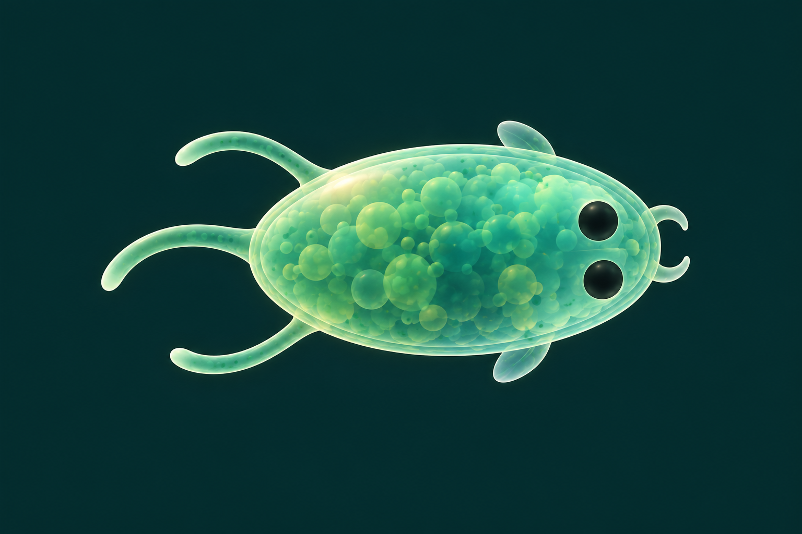
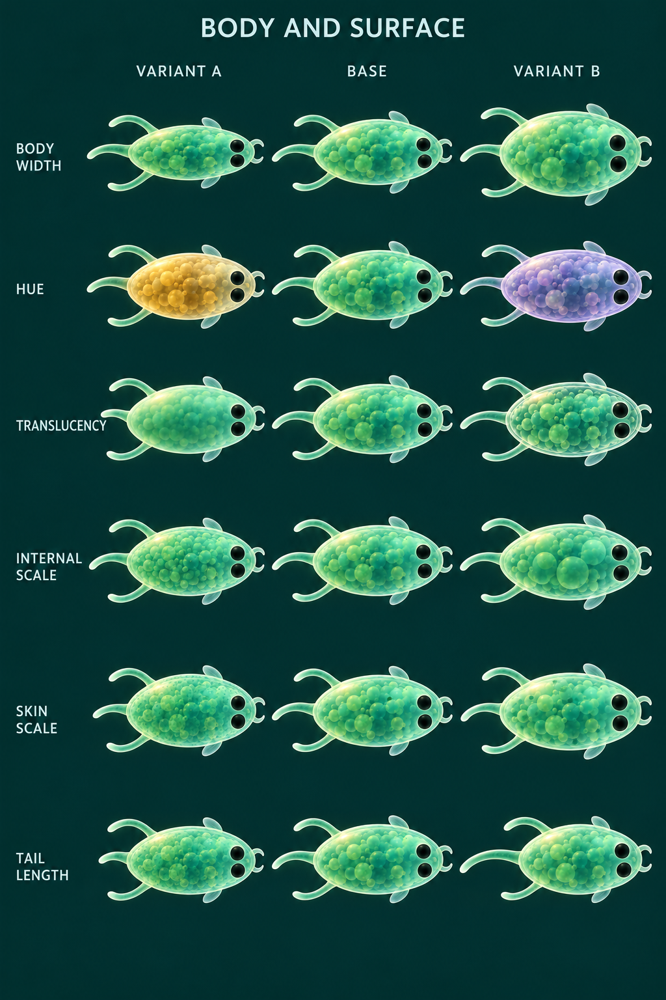
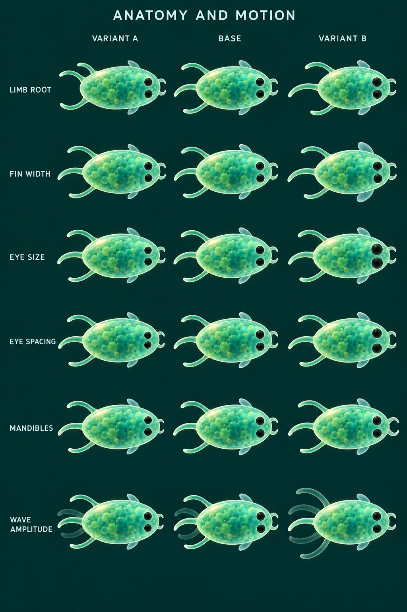

# Inherited visual traits and concept grids

25 October 2026. Proposed appearance controls for Worms, extending the chosen
[dark pond visual direction](VISUALS.md). This is an art and implementation brief,
not a list of features already implemented.

## Trait list

Each group below contains several controls. The initial concept grids vary one
representative control from each group; they do not exhaust every combination.

| Group | Concrete controls | First grid example |
|---|---|---|
| 1. Body silhouette and proportions | Width-to-length ratio, front and rear taper, roundness/fullness, slight curvature and bilateral asymmetry. Overall length follows the existing physical size trait. | Body width |
| 2. Colour | Primary and secondary hue, saturation, brightness, blend amount and gradient position/direction; optional separate appendage tint. | Hue |
| 3. Membrane and material | Translucency, apparent internal density, rim thickness/tint, surface roughness, highlight strength and subtle iridescence. | Translucency |
| 4. Internal pattern | Inherited noise seed; pocket and granule scale/density, layer weights, stretch, orientation, offset, warp, contrast, softness and apparent depth. | Internal pocket scale |
| 5. Skin pattern | Surface spots, bands and mottling; scale, density, orientation, phase, contrast, edge softness, coverage and pigment. Blend motifs gradually where possible. | Surface freckle scale |
| 6. Tail | Prominence, length, root width, taper, rest curvature/curl, tip shape, attachment position and angle. A simple fan or fork is a later topology option. | Tail length |
| 7. Limbs | Prominence, length, thickness, bend/curl, taper, attachment position, spread angle and bilateral offsets. A small bounded number of pairs is a separate option. | Limb root position |
| 8. Fins | Prominence, span, chord/width, sweep, rounded-to-pointed outline, edge curvature/scalloping, attachment position/angle and translucency. | Fin width |
| 9. Eye shape and size | Diameter, oval aspect ratio, roundness, tilt, tint and optional rim strength. Keep two simple eyes initially. | Eye diameter |
| 10. Eye placement | Separation, forward/back position, outward angle and slight paired asymmetry, bounded to keep both eyes readable on the body. | Eye spacing |
| 11. Mandibles | Prominence, length, thickness, taper, curve, root separation/position, resting opening angle and tip roundness. | Mandible length |
| 12. Motion character | Tail/limb wave amplitude, frequency, wavelength, stroke shape, left/right phase relationship, fin flutter, resting jaw movement and subtle body pulse. | Wave amplitude, shown with ghost poses |

For each appendage, use the same basic language: **presence/prominence, shape,
size, attachment position, orientation and material**. Express attachment and
dimensions in body-relative coordinates so inherited proportions survive changes
in body size. Shape-specific controls then describe tail curl, fin sweep, jaw
opening and so on.

The useful additions to the user's initial list are body silhouette, material
transparency/finish, membrane character, mandibles and movement style. Asymmetry
is a small bounded option within each feature, not a requirement to make creatures
lopsided.

## Inheritance and scope

Start with continuous changes and a small anatomy vocabulary. Copy the parent's
values to both children and apply small independent bounded mutations. Retain the
pattern seed so noise parameters drift around recognizable features. A change in
appendage count, a forked tail or a categorical new motif is a separate topology
decision, not a frequent random redraw at birth. Near-zero prominence can let
existing fins or jaws emerge gradually.

Current physical size already affects the simulation. Visual body length must
follow that trait; do not add an unrelated cosmetic scale that misrepresents it.
Other shape controls begin as cosmetic, with bounds that keep apparent contact
and sensed size understandable. Any future mechanical effect of fins, mandibles
or eyes needs an explicit gameplay decision.

Inherited motion controls describe a characteristic movement style. The current
animation phase, speed-driven stroke intensity, energy state, age, damage,
temporary illumination, ripples and food/combat particles are state or events.
They are not copied as inherited appearance genes. Newborns can receive a
deterministic individual phase without changing their inherited rhythm.

## Canonical base and first concept grids



The reference includes one central tail, one limb pair, one fin pair, two eyes
and small paired mandibles so each feature can be explored. This is a comparison
baseline, not a requirement for every creature to express every appendage.





The intended layout is one control per row and variant A / base / variant B
across columns. Each column in the motion row uses a solid rest pose with faint
ghosts suggesting its movement envelope; this is not an animation preview.
Labels such as skin scale refer to marking size, not literal scales on the skin.

These are AI-generated art studies. They show the intended comparisons but have
incidental changes in some anatomy, pose, pattern and scale between cells.
They are not exact parameter sweeps or evidence of renderer behavior. In
particular, the limb-root and fin-width differences are subtle, the base is not
pixel-identical in every cell, and motion ghosts are illustrative. Use the
images to discuss the direction, not to assign numeric gene values.

For the later procedural grid, fix the following:

- The same baseline appearance vector and pattern seed in every cell.
- Camera, heading, physical length, light, exposure and screen scale.
- One scalar parameter per row; apply only the row's change to the shared base.
- The same simulation time and animation phase for static comparisons.
- Clear low/base/high values or units alongside each row.
- For motion, identical sampled times or looping previews in every column.
- Separate sheets for categorical tail, fin, eye and marking shapes, then a
  combined-family sheet to check that accumulated mutations remain recognizable.

This separates parameter legibility from attractive finished compositions.
Range tuning, inheritance rates and renderer performance remain future work.
No simulation, renderer or checkpoint format changed for this concept pass.

## Provenance and final prompts

Generated with the built-in image-generation tool on 25 October 2026, all with
opaque backgrounds. The canonical base edits
[the family morphology study](../assets/concepts/pond-family-morphology.png).
Both grids edit the saved canonical base. Original tool outputs are retained;
project images are stored in `assets/concepts/`.

### Canonical base

```text
Use case: style-transfer
Asset type: canonical base creature for a controlled visual-trait concept grid for Worms. A design reference, not a game screenshot.
Edit target: supplied pond-family-morphology.png. Extract the visual language of the top-left jade organism and recompose into ONE isolated baseline specimen. Preserve the living translucent ellipsoid material, muted jade pigment, faint cellular interior, delicate pearly membrane, simple dark eyes and short soft appendages. Remove every other organism and all labels.
Composition: single horizontal oval creature centered, HEAD TO THE RIGHT and rear to the LEFT, orthographic top-down view. Body length about twice body width. Full creature visible, no perspective tilt. Quiet uniform very dark teal background with no bokeh, no dust, no food, no floor or cast shadow. Landscape 3:2 image. Specimen fills about 65 percent of width and 50 percent of height, with generous margins for future appendage variants.
Canonical anatomy: two modest round dark eye dots at the right end, one above and one below the horizontal body axis, clearly inset inside the body. ONE short slender tapered tail attached at the exact rear-left end, curving softly downward, about one fifth of body length. ONE paired set of slim curved limbs attached symmetrically on the upper and lower rear flanks, each about one fifth of body length. ONE pair of tiny translucent rounded paddle fins attached on the upper and lower mid-front flanks, each about one tenth of body length. ONE pair of very small smooth translucent crescent mandibles at the front-right tip, ahead of the eyes, each no more than one fifteenth of body length. Keep all appendages visibly separate, simple and delicate; no insect-like segmentation.
Material baseline: soft jade translucent cytoplasm with sparse medium-sized rounded internal pockets, very faint small darker jade freckles on the membrane, thin pale mint membrane edge, restrained upper-left warm highlight and cool opposite edge. No strong gold marking, no neon outline. Internal pockets, surface freckles and eyes should be separately legible, with the eyes much darker and larger than freckles. Soft cellular texture, not polished plastic or glass.
Purpose: a neutral baseline with all major traits available to vary in later diagrams. Calm, friendly microscopic organism, not an elaborate animal. Exact two eyes, one tail, one limb pair, one fin pair, one tiny mandible pair.
Avoid: words, letters, labels, UI, grids, multiple specimens, bright glow, bokeh, environmental debris, bubbles outside body, extra appendage pairs, long tentacles, fish scales, teeth, veins, elaborate anatomy, dramatic expression.
```

### Body and surface grid

```text
Use case: style-transfer
Asset type: controlled visual-trait comparison grid for the microscopic game Worms. Concept art only.
Edit target: the attached trait-base.png. Recompose the exact specimen into a portrait art-direction matrix. The source defines the canonical BASE: horizontal jade ellipsoid, head right, two dark eyes, one rear center tail, one pair of curved rear-side limbs, two small translucent side fins, tiny paired front mandibles, thin membrane, soft internal pockets and faint skin speckles.
Layout: tall portrait sheet approximately 2:3, SIX rows by THREE columns, 18 specimens total. Crisp readable row labels in a left margin and column headings "VARIANT A", "BASE", "VARIANT B" across the top. Each row must show THREE organisms, one in each column. Uniform dark teal background without bokeh, particles, scene decoration, cards, boxes or grid lines. Generous separation. Every organism fully inside its cell, same physical body LENGTH and same horizontal heading with head right, unless explicitly changing length (none of these rows changes body length). Leave enough room around every specimen for appendage changes.
Controlled comparison: the central BASE column repeats precisely the same reference organism in all SIX rows. All row variants keep the same base anatomy, pigment, lighting, membrane, internal pattern, pose, framing and scale except for the SINGLE control specified for that row. This is not a species sheet or a mood board. Do not redesign a creature to make a row different. Use conspicuous but tasteful parameter variations so the chosen variable is easy to identify at thumbnail size. Keep exactly two eyes, one center tail, one limb pair, one fin pair and one mandible pair in every specimen.
Style: polished microscopy-inspired translucent organism concept art matching the reference, soft consistent upper-left light, fine warm membrane highlights and cool shadows, controlled bloom, clear eyes. All specimens sharp. A quiet technical comparison presented beautifully.

Exact title above the column headings: "BODY AND SURFACE"
Exact row labels and changes from TOP to BOTTOM:
1. "BODY WIDTH": left creature has a slim oval body at 65 percent of base width; center is unchanged base; right has a plump oval body at 130 percent of base width. Keep body length, pigmentation, eye diameter, and all appendage shapes unchanged. Attachment roots naturally follow the changed body surface.
2. "HUE": left changes ONLY jade body pigmentation to soft warm amber; center jade base; right changes ONLY body pigmentation to soft lavender. Keep identical silhouette, appendages, eye size and positions, internal pocket pattern and material transparency.
3. "TRANSLUCENCY": left has a cloudier more opaque body, center the original semitransparent base, right a clearer more transparent body. Keep green pigment hue and ALL geometries, eye features and pattern positions fixed; interior visibility changes only as a consequence of transparency.
4. "INTERNAL SCALE": left has many smaller soft internal cellular pockets, center reference-sized pockets, right fewer larger soft pockets. Keep overall internal coverage and contrast similar. The surface freckles, membrane, colour and geometry do not change.
5. "SKIN SCALE": left has a clearly visible layer of fine small dark-jade surface freckles; center reference medium fine surface freckles; right has fewer visibly larger dark-jade surface freckles. This is a surface-marking-scale study: keep the rounded internal pockets unchanged. Keep marking coverage comparable and all other features fixed. The freckles are smaller and lighter than the eyes.
6. "TAIL LENGTH": left has a noticeably shorter rear CENTER tail, center reference tail, right a noticeably longer center tail. Keep the two SIDE limbs, fins, jaws, eyes, body and material exactly unchanged. Tail curvature and taper are the same, simply scaled along its length.
No extra rows or captions. No row swapping. No arrows or annotations inside specimens. Keep the baseline consistent in every row. Do not change features other than the row's named control.
```

### Anatomy and motion grid

```text
Use case: style-transfer
Asset type: controlled visual-trait comparison grid for the microscopic game Worms. Concept art only.
Edit target: the attached trait-base.png. Recompose the exact specimen into a portrait art-direction matrix. The source defines the canonical BASE: horizontal jade ellipsoid, head right, two dark eyes, one rear center tail, one pair of curved rear-side limbs, two small translucent side fins, tiny paired front mandibles, thin membrane, soft internal pockets and faint skin speckles.
Layout: tall portrait sheet approximately 2:3, SIX rows by THREE columns, 18 specimens total. Crisp readable row labels in a left margin and column headings "VARIANT A", "BASE", "VARIANT B" across the top. Each row must show THREE organisms, one in each column. Uniform dark teal background without bokeh, particles, scene decoration, cards, boxes or grid lines. Generous separation. Every organism fully inside its cell, same physical body LENGTH and same horizontal heading with head right, unless explicitly changing length (none of these rows changes body length). Leave enough room around every specimen for appendage changes.
Controlled comparison: the central BASE column repeats precisely the same reference organism in all SIX rows. All row variants keep the same base anatomy, pigment, lighting, membrane, internal pattern, pose, framing and scale except for the SINGLE control specified for that row. This is not a species sheet or a mood board. Do not redesign a creature to make a row different. Use conspicuous but tasteful parameter variations so the chosen variable is easy to identify at thumbnail size. Keep exactly two eyes, one center tail, one limb pair, one fin pair and one mandible pair in every specimen.
Style: polished microscopy-inspired translucent organism concept art matching the reference, soft consistent upper-left light, fine warm membrane highlights and cool shadows, controlled bloom, clear eyes. All specimens sharp. A quiet technical comparison presented beautifully.

Exact title above the column headings: "ANATOMY AND MOTION"
Exact row labels and changes from TOP to BOTTOM:
1. "LIMB ROOT": left has the pair of curved SIDE limbs attached closer to the rear, center is unchanged baseline, right has the same side limbs attached further forward along the flanks. Keep each limb's length, bend, thickness and angle identical relative to its root. Do not move the center tail or fins.
2. "FIN WIDTH": left has very narrow translucent paddle fins; center reference fins; right broader translucent paddle fins. Change only the two fins' paddle width, keeping their root positions, span from the body, colour and all other structures fixed. Make the broadened fins visibly distinct from the curved rear limbs.
3. "EYE SIZE": left has smaller round dark eyes, center reference eyes, right larger round dark eyes. Keep eye centres absolutely fixed, and all body features unchanged.
4. "EYE SPACING": left has the two eyes closer to each other vertically; center reference eye spacing; right has the eyes further apart vertically. All eyes retain the exact reference size and horizontal front-to-back position. Keep both eyes inside the body.
5. "MANDIBLES": left has shorter tiny paired mandibles at the front RIGHT of the face; center reference mandibles; right has longer paired mandibles with the same gentle curvature and opening angle. All eyes, body, tail, limbs and fins unchanged. No sharp teeth or weapon shapes.
6. "WAVE AMPLITUDE": in every column show the identical central baseline creature, but illustrate the swept motion of the rear CENTER tail using EXACTLY TWO very faint translucent ghost tail curves around the solid central tail. Left: a narrow swing envelope; center: medium swing envelope; right: wider swing envelope. The solid creature and all other appendages are unchanged. Ghosts indicate sampled motion positions, NOT extra tails or extra organisms. No ghost bodies, no arrows, no particle trails. Only this last row has ghost curves.
No extra rows or captions. No row swapping. No arrows or annotations inside specimens. Keep the baseline consistent in every row. Do not change features other than the row's named control.
```
